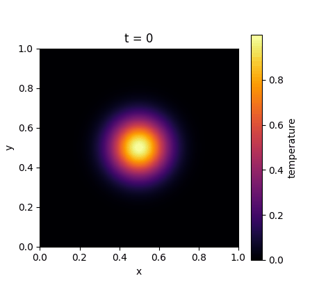

# Parallel Heat Diffusion Solver (MPI + OpenMP)

[](https://github.com/SidhartSami/pdc-heat-diffusion/actions/workflows/ci.yml)
[](LICENSE)
[](https://en.cppreference.com/w/cpp/17)

A hybrid distributed and shared-memory solver for the 2D and 3D heat equation,
u_t = alpha * laplacian(u), using an explicit forward-time central-space (FTCS) scheme.
Built for the Parallel and Distributed Computing course (Project 12, stencil computation).

<p align="center">
  
</p>

## Features

- 5-point (2D) and 7-point (3D) stencils with Dirichlet and Neumann boundaries
- MPI Cartesian domain decomposition with non-blocking halo exchange
- Optional overlap of communication with interior computation
- OpenMP threading, first-touch initialisation, core pinning, 3D cache blocking
- Parallel VTK output (open `heat.pvd` in ParaView) and bit-exact checkpoint/restart
- Parallel result is bit-identical to the serial result for 1 to 8 ranks

## Results

Measured on an Intel i5-12500H (4 P-cores) under WSL2. Full data is in `results/`.

| Problem | 1 core | 4 cores | Speedup |
|---|---|---|---|
| 2D, 4096 x 4096, 100 steps | 3.13 s | 1.12 s | 2.80x |
| 3D, 512^3, 50 steps | 22.3 s | 6.93 s | 3.22x |
| 2D, 8192 x 8192, 5000 steps | 452.6 s | 184.8 s | 2.45x (single run) |

The stencil is memory-bandwidth-bound, so efficiency is below linear. On a single node,
communication/computation overlap showed no measurable difference (see the report).
All numbers come from one machine; there are no multi-node runs.

## Build and test

Requires a C++17 compiler, CMake 3.20 or newer, an MPI implementation (tested with OpenMPI 5),
and OpenMP.

```bash
cmake --preset release
cmake --build --preset release
ctest --preset release --output-on-failure
```

## Run

```bash
export OMP_NUM_THREADS=2
mpirun -np 4 ./build/release/heat_solver --config=configs/small_2d.cfg

# Common overrides
#   --dim=2|3 --nx= --ny= --nz= --steps= --dt=auto --overlap=true|false
#   --ic=sine|gaussian|step --boundary=dirichlet|neumann
#   --snapshot-freq=N --output=DIR
#   --checkpoint-freq=N --checkpoint-path=P --restart-from=P
```

`./demo.sh` runs a short end-to-end demonstration (correctness, speedup, visualisation, restart).
`python analysis/visualize.py DIR` renders snapshots to PNG and GIF.

## Repository layout

| Path | Contents |
|---|---|
| `include/heat/`, `src/` | Solver library and driver |
| `tests/` | GoogleTest suites (serial, MPI, I/O) |
| `configs/` | Example run configurations |
| `bench/`, `results/`, `analysis/` | Benchmark scripts, raw data, analysis and figures |
| `docs/` | Design notes, architecture decision records, proposal, report |

## Documentation

- [Report](docs/report/report.md)
- [Design](docs/design.md)
- [Architecture guide](docs/hpc_architecture_guide.md)
- [Roofline model and stability analysis](docs/analytical_roofline_and_defense.md)
- [Architecture decisions](docs/adr/)
- [Project status](STATUS.md)

## Authors

- Sidhart Sami
- Abdul Rafy ([@Abdul-Rafy2005](https://github.com/Abdul-Rafy2005))

## AI assistance

Parts of this project were developed with assistance from Claude Code (Anthropic). Commits that include its contribution carry a `Co-Authored-By` trailer. All results were produced by running the code in this repository.

## License

MIT. See [LICENSE](LICENSE).
